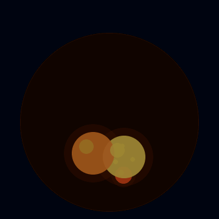
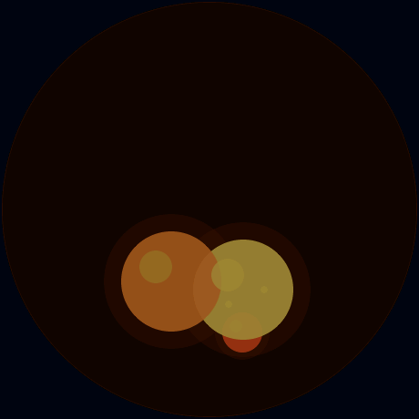
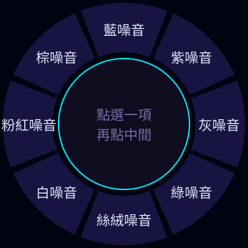
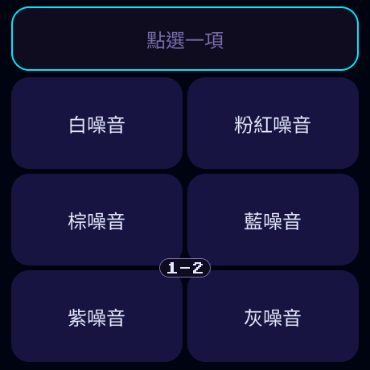
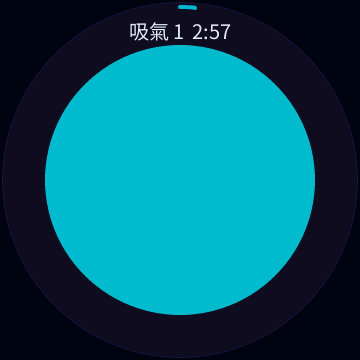
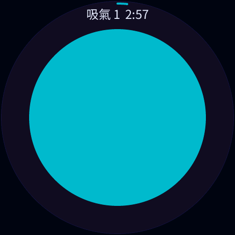

# 9. 氛圍、白噪音與呼吸

- **氛圍頁：** 熔岩燈、魚缸、篝火、夜燈。安靜的動畫，音樂播放時螢幕可以一直亮著。
   
- **白噪音：** 合成的噪音顏色（白、粉紅、棕…）加上睡眠包 `_player/sleep/library.muk` 裡的情境（雨聲等；我們自己合成的包：`make noise-pack`）。也可以自己編情境。
   
- **呼吸：** 引導式呼吸圓環，可選呼吸音。
   

下一章：[快捷面板](10-quick-settings.md)。
