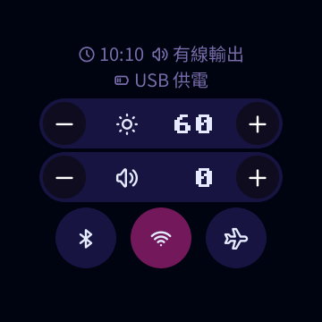
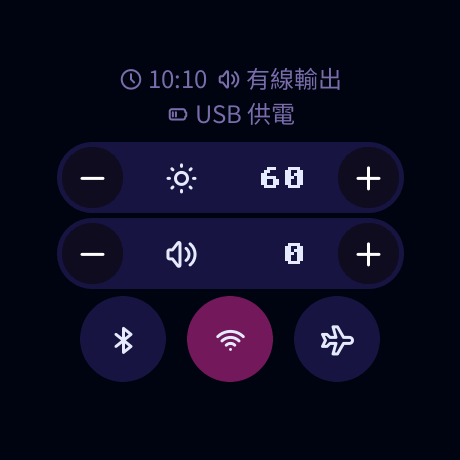
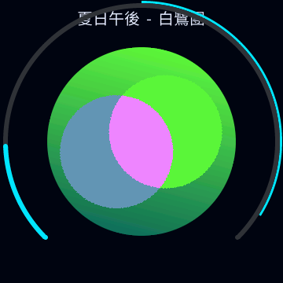
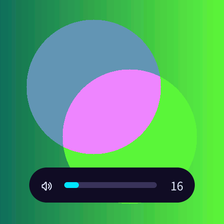

# 10. 快捷面板

在任何地方快速往下滑（遊戲中也行，會暫停遊戲）。快速往上滑、點面板外或 4 秒不動就會關閉。

 

- **狀態列：** 時間、電量（FakePod：AXP2101 百分比；圓形主板沒有電量計，只顯示電源來源：USB 或電池）、目前輸出（喇叭／有線／藍牙名稱）。
- **亮度**（太陽圖示）與**音量**（喇叭圖示）：各一條膠囊，左端 −、右端 ＋，中間是圖示和數字（亮度每次 10、音量每次 1，受音量上限限制）。旋鈕照舊調音量。音量是**依輸出各自記的**：有線一個、每支藍牙耳機各一個、藍牙喇叭模式一個，目前調的是目前輸出的那一個（第 5 章）。
- **音量提示：** 轉旋鈕（FakePod 按上下鍵）調音量時，圓形板在螢幕邊緣顯示一道弧線，FakePod 在下方顯示一個膠囊（喇叭圖示、音量條與數字），幾秒後自動消失。

 

- 三顆圓形開關，由左到右：**藍牙**、**允許 Wi-Fi**、**飛航模式**（一鍵關藍牙並不允許 Wi-Fi）。亮色＝開。需要重新開機才生效的開關，第一下會變成電源圖示、下面寫「重新開機後生效」，再點一次才執行。
- 目前開機模式做不到的項目（例如 Auracast 廣播時的 Wi-Fi）會變灰並附一行原因。

下一章：[設定](11-settings.md)。
