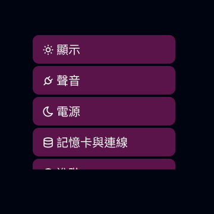
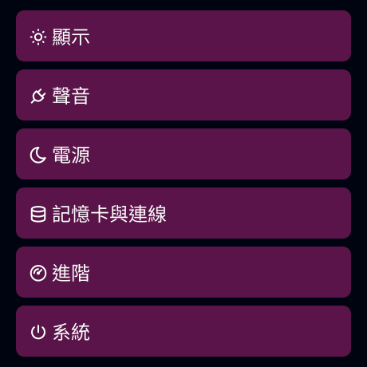
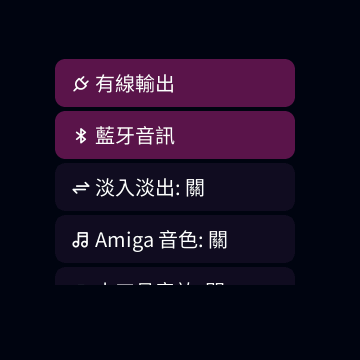
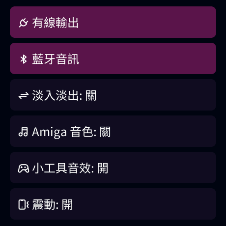
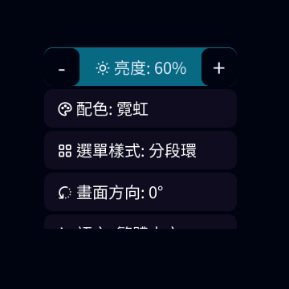
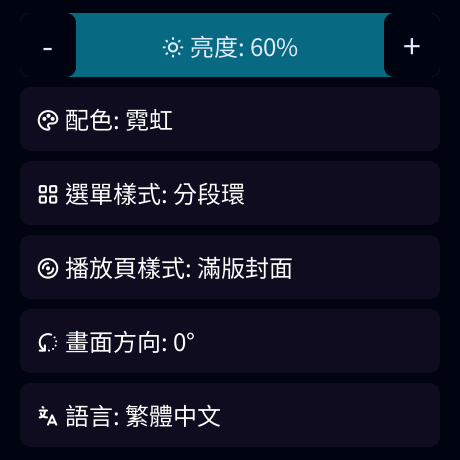

# 11. 設定

 

裝置上只放常用設定，細項在網頁工具（第 13 章）：時區、日出地點、音效預設、電台清單、有線細項。

## 六個類別
設定頁頂層是**六個類別頁**（顯示、聲音、電源、記憶卡與連線、進階、系統）加說明；會開另一頁的列用自己的底色。每一類裡有：

| 類別 | 內容 |
|---|---|
| 顯示 | 亮度、配色、選單樣式、播放頁樣式（只有 FakePod）、畫面方向（0° 或 180°）、語言（繁中／简中／English） |
| 聲音 | 有線輸出、藍牙音訊、淡入淡出（關／2／4／6 秒，只在前後兩首取樣率相同時作用）、Amiga 音色、小工具音效、震動（只有圓形板） |
| 電源 | 睡眠定時、自動關機（只有 FakePod：關／10／30／60 分） |
| 記憶卡與連線 | 重新掃描曲庫、封面快取、記憶卡診斷（第 12 章）、USB 隨身碟模式（第 14 章）、Wi-Fi（只顯示設定好了沒有，帳密在網頁工具輸入） |
| 進階 | 取樣率測試、實驗性格式（預設關；點兩下才開，說明見第 3 章）、CPU 時脈（實驗性） |
| 系統 | 設定時間（第 6 章）、手勢教學（重看）、重開機 |

需要重開機的項目會註明。播放倍速（0.75x 到 2x）在播放環上，不在這裡。

 

## 值列怎麼用
值列第一下只選中：左端出現「-」、右端出現「+」小標。選中後再點**左半邊減一格、右半邊加一格**，到頭就停（配色與語言是循環）；也可以轉旋鈕（FakePod 按上下鍵）。

 

網頁工具的進階區也有「實驗性格式」同一項。

只在網頁工具裡（第 13 章）：音量上限、按住回首頁的時間（2／3／4 秒）、震動強度與長度、藍牙耳機連線選項、ReplayGain、有線字長、字型來源等進階項目。

另有現況頁，顯示實際輸出取樣率與位元率、underrun 次數，以及某功能被暫停時的原因。

**有線與藍牙的上限。**有線取樣率相關設定在 設定 > 聲音 > 有線輸出；編碼上限與 LDAC 最高位元率在 設定 > 聲音 > 藍牙音訊（第 17 章）。主題配色見第 18 章；說明頁會為 `setup_url` 的每個網址各顯示一個 QR。

下一章：[卡片設定與設定檔](12-card.md)。
