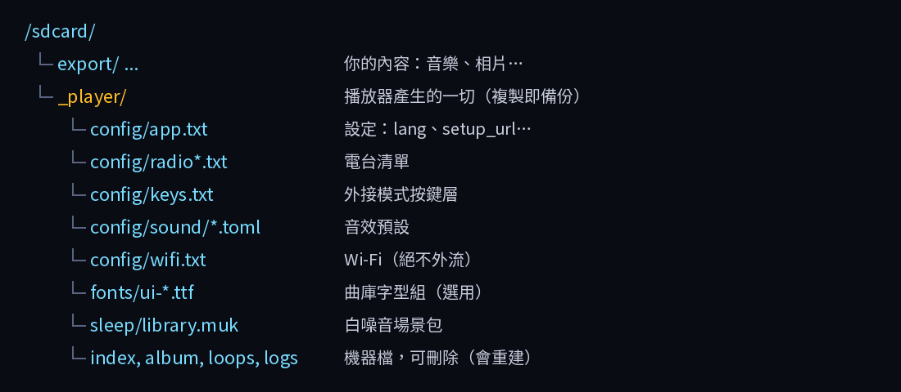
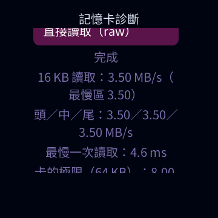
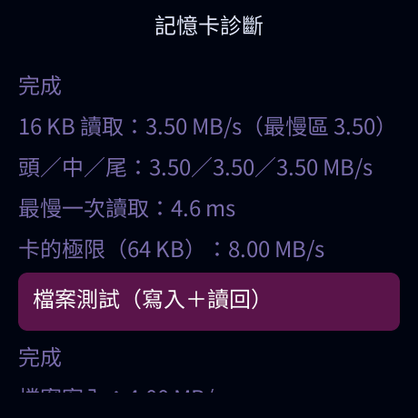
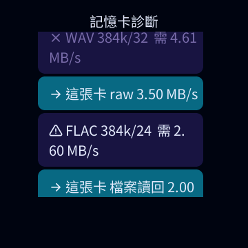
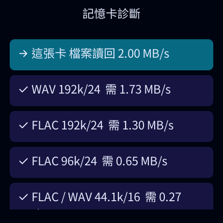

# 12. 卡片設定與設定檔


- **卡片內容包。** 從 Releases 頁面下載 `jukedial-<版本>-card.zip`，解壓縮到卡的根目錄。裡面有 `_player/pack.txt`；「現況」頁會顯示內容包版本，內容包缺少或比韌體要求的舊時會警告。

- **卡：** FAT32 或 exFAT（大容量 exFAT 出廠卡可用），分割表必須是 **MBR**、一個分割區（或沒有分割表）。GPT 的卡掛載失敗（「sd mount failed reason=gpt」）。**2 GiB 以上的檔案會被略過。** 裝置只有在掛載失敗之後才會格式化，而且要看警告、連點幾下、最後再點一個武裝格。播放中不要拔卡。
- **資料夾。** 你的內容放最上層；JukeDial自己產生的東西都在 `_player/` 裡（備份＝複製它）。

| 路徑 | 內容 |
|---|---|
| `export/<專輯>/*.mp3 cover.jpg` | 你的音樂：只掃描 `export/`，一層資料夾（一個資料夾＝一張專輯）；支援 MP3、FLAC、Ogg／Opus、M4A、WAV 與模組音樂；2 GiB 以上的檔案會略過 |
| `lists/*.zip`、`vocab/*.zip` | 單字卡清單，用 `tools/gen/make_lists.py`、`tools/gen/make_vocab.py` 製作，由網頁工具上傳 |
| `photos/*.jpg` | 相片 |
| `chiptune/<系統>.zip` | 晶片音樂 |
| `fortune/omikuji.txt`、`wheel.txt` | 覆蓋內建的籤詩與轉盤文字 |
| `instrument/kits/<名稱>/` | 取樣套組 |
| `_player/config/app.txt` | 設定：`lang`、`setup_url`（空白隔開、最多 4 個網址，第一個為主；說明頁每個網址一個 QR）… |
| `_player/config/radio*.txt` | 電台清單 |
| `_player/config/keys.txt` | 外接模式的按鍵層（卡片範本附 `.example`） |
| `_player/config/sound/*.toml` | 音效預設（匯入／匯出） |
| `_player/config/wifi.txt` | Wi-Fi 網路。這個檔絕不要分享或放進版本庫。兩行：`ssid=...` 與 `pass=...`；JukeDial不會顯示或記錄它 |
| `_player/fonts/ui-tc.ttf、ui-sc.ttf、ui-ext.ttf` | 曲庫字型組（選用；沒有就用快閃裡的字型） |
| `_player/faces.zip` | 時鐘、碼錶、倒數、番茄鐘的 HUD 錶面（一個不壓縮的 zip，在卡片範本裡；沒有它就不提供 HUD 選項，這些功能用一般錶面） |
| `_player/themes/<名稱>.txt` | 主題配色（卡片範本附十個，另有 `template.txt`；第 18 章） |
| `_player/splash/<模式>.jpg`、`_player/splash.jpg` | 開機畫面（見下） |
| `_player/sleep/library.muk` | 白噪音情境包 |
| `_player/index`、`album`、`loops`、`logs` | 機器檔，可以刪（會重建） |

## 不用網頁工具也能改的設定檔

下面這些純文字檔可以用任何編輯器修改：用讀卡機，或讓電腦透過裝置的 USB 隨身碟模式（第 14 章）。編碼用 UTF-8，換行用一般的換行字元。以 `#` 開頭的行是註解。

| 卡上的路徑 | 控制什麼 | 格式 | 何時生效 |
|---|---|---|---|
| `_player/config/app.txt` | 裝置設定（語言、亮度、音量上限等） | 每行 `鍵=值`，前後空白會被去掉 | 下次開機。裝置自己改設定時會重寫整個檔案，所以請在裝置關機、或卡在電腦上時修改 |
| `_player/config/wifi.txt` | Wi-Fi 網路（電台、對時用） | 兩行 `ssid=…` 與 `pass=…`；`pass` 留空代表開放網路 | 下次連 Wi-Fi 時（需要時才連線）。這個檔絕不要分享 |
| `_player/config/radio.txt`、`radio_<名稱>.txt` | 電台清單（`<名稱>` 只能用小寫英文、數字、`_`、`-`） | 每行一台：`電台名稱\|網址`，最多再加兩個以 `\|` 分隔的備援網址 | 下次打開電台頁 |
| `_player/config/keys.txt` | 外接模式的按鍵層 | 從卡片包的 `keys.txt.example` 複製後修改；格式說明在外接模式畫面的說明頁 | 進入外接模式時，以及電腦退出卡之後重讀。任何一行有錯，整個檔案都不採用，改用預設的媒體鍵層 |
| `fortune/omikuji.txt` | 籤詩的內容 | 每行一支籤：`等級\|詩句`，等級是 大吉、吉、中吉、小吉、末吉、凶，或 `*`（任何等級）；沒有 `\|` 的行當作任何等級的詩句；詩句裡的 `/` 是換行；最多 64 句 | 下次打開籤詩 |
| `fortune/wheel.txt` | 轉盤的選項 | 每行一個選項，最多 12 個 | 下次打開轉盤 |

`app.txt` 裡確定可以手動改的鍵（其他鍵請用裝置上的設定畫面或網頁工具，不要猜）：

| 鍵 | 意義 |
|---|---|
| `lang` | 介面語言：`0` 繁體中文、`1` 简体中文、`2` English |
| `brightness` | 亮度百分比（預設 60） |
| `volume_max` | 音量上限（預設 100） |
| `splash` | `0` 關閉開機畫面（預設開） |
| `home_hold_ms` | 按住回首頁的時間：`2000`、`3000` 或 `4000` 毫秒（預設 3000） |
| `tz` | 時區，POSIX 格式，例如 `CST-8` |
| `setup_url` | 說明頁 QR 的網址，空白隔開，最多 4 個 |

範例（數值都是虛構的）：

```
# _player/config/app.txt
lang=2
brightness=70
splash=0
tz=CST-8

# _player/config/wifi.txt
ssid=MyNetwork
pass=password123

# _player/config/radio.txt
Sample FM|http://example.com/stream.mp3
Sample News|http://example.com/news.aac|http://backup.example.com/news.aac

# fortune/omikuji.txt
大吉|晴天配好歌/一路都順風
*|今天的歌單由你決定

# fortune/wheel.txt
Pizza
Noodles
Salad
```

單字與單字卡清單由網頁工具上傳（用 `tools/gen/make_lists.py`、`tools/gen/make_vocab.py` 也能自己做）；其餘的設定只能在裝置畫面或網頁工具裡改。

## 記憶卡診斷

設定 > 記憶卡與連線 > 記憶卡診斷，告訴你這張卡跟得上哪些格式（高取樣率的 FLAC、WAV 需要持續的讀取速度，慢卡會卡頓）。測試期間播放會停止，離開頁面就中止。

 

- **兩個互不合併的分數。** *直接讀取*只讀、不經過檔案：在卡的開頭、中間與尾端三個區域各讀一小段，報平均、最慢區與最慢一次讀取（頭條數字是解碼器用的 16 KB 讀法，另有 64 KB 讀的卡極限）。*檔案測試（寫入＋讀回）*會在卡上寫一個 4 MB 暫存檔、讀回比對、刪除；要點兩下才開始，第一下說明會寫入，剩餘空間要至少 8 MB。
- **格式天梯。** 依需求由重到輕列出七種格式，各有判定圖示：可以、勉強、不夠。需求速度是該格式串流每秒位元組數的 **1.5 倍**（留給定位、檔案配置表與忙碌的卡；FLAC 以未壓縮大小的 75 % 計）；速度達到需求是「可以」，達到需求的 75 % 是「勉強」，其餘「不夠」。

  | 格式 | 需求速度（約） |
  |---|---|
  | MP3／AAC／Opus 320k | 0.06 MB/s |
  | FLAC／WAV 44.1k/16 | 0.27 MB/s |
  | FLAC 96k/24 | 0.65 MB/s |
  | FLAC 192k/24 | 1.3 MB/s |
  | WAV 192k/24 | 1.7 MB/s |
  | FLAC 384k/24 | 2.6 MB/s |
  | WAV 384k/32 | 4.6 MB/s |

  各格式的判定看檔案讀回的速度；沒做檔案測試時才看直接讀取。

   
- **揭露。** 這些門檻是估計值，不是保證：只用一張卡校準、只讀三個區域各幾秒，卡的其他位置仍可能有慢點。頁面底下有同樣的說明。最近一次的結果存在 `_player/cardtest.txt`，只留最新一次、只對同一張卡有效。

## 開機畫面

開機時可以先顯示一張圖，背光緩緩亮起、變暗、再亮回來一次，然後照常開機。

- **檔名。** 每種開機方式一張：`_player/splash/player.jpg`（一般開機）、`usb.jpg`（USB 隨身碟／鍵盤／音效卡模式）、`inst.jpg`（樂器）、`cast.jpg`（廣播電台），只有 FakePod 另有 `charge.jpg`（充電畫面）。某個模式沒有自己的檔，就用 `_player/splash.jpg`；兩個都沒有就不顯示，開機跟以前一樣快。
- **建議的圖。** **360 × 360 的 baseline JPEG**（不要 progressive），黑底，圖樣放在內切圓裡：圓屏正好顯示這個圓，FakePod 的方屏把同一張置中、四周留黑邊。檔案不超過 1 MiB。不會縮放，其他尺寸會 1:1 顯示、超出螢幕的部分被裁掉。
- **預設圖。** 卡片包的 `_player/splash/` 已經附每個模式一張：一個大圖示（`player` 是音樂圖示加字標「JukeDial」）。想換就覆蓋該檔；刪掉則改用 `splash.jpg`，再沒有就不顯示。
- **關閉。** 網頁工具「裝置」分頁（螢幕組）的「開機畫面」選「關」（下次開機生效），或在 `_player/config/app.txt` 加一行 `splash=0`。
- **代價。** 有圖時，第一個畫面與第一個聲音約晚 **2 秒**。當機後的那一次開機不會顯示。

現成的卡片範本用 `make card-zip` 產生。

下一章：[網頁工具與刷機](13-web-tool.md)。
