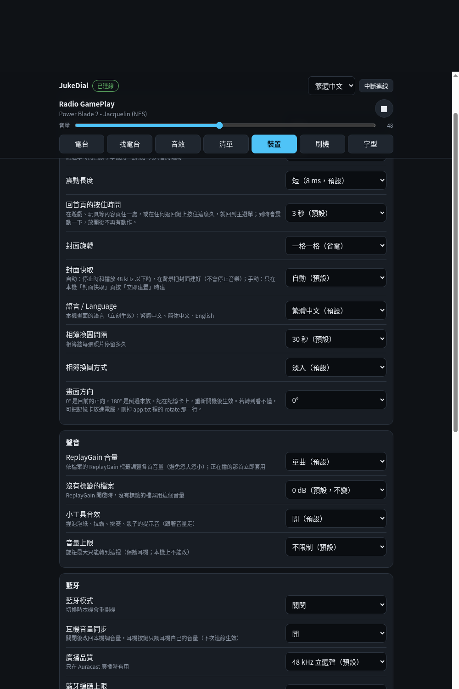
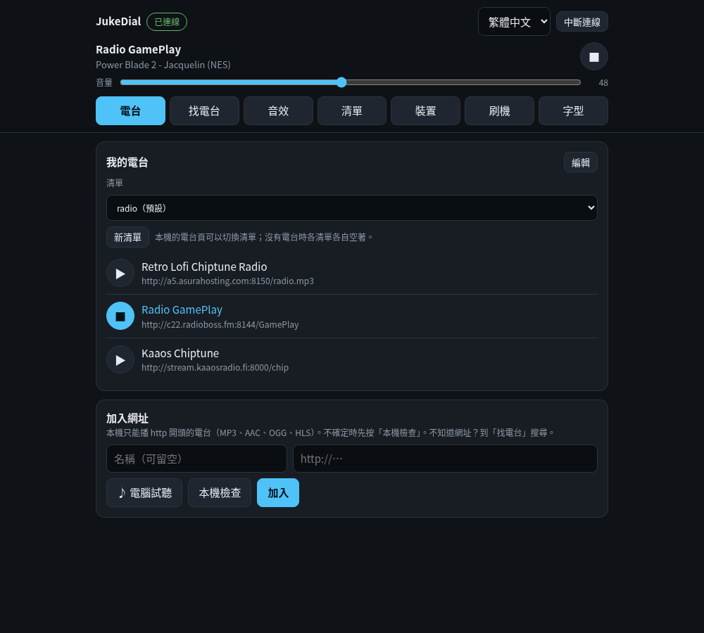
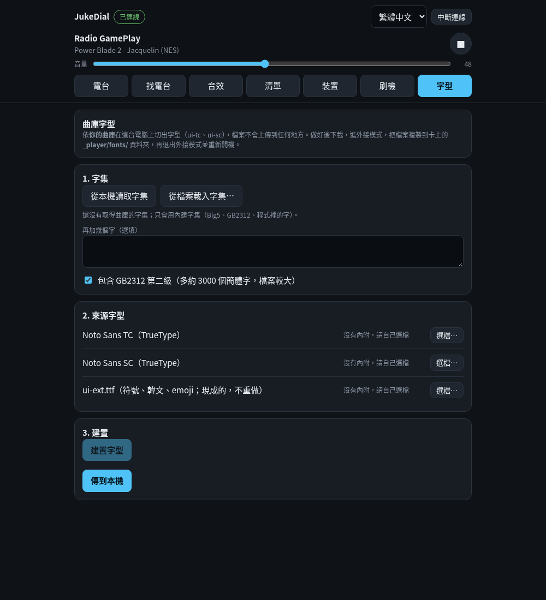
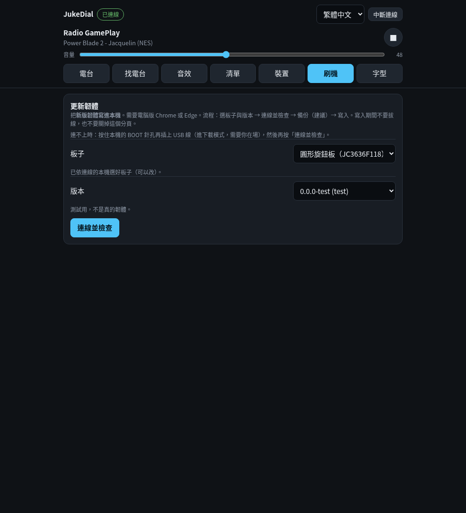

# 13. 網頁工具：設定、電台清單、字型與刷機



一個靜態網頁（`tools/web/`，三種語言），經 USB 序列埠和JukeDial溝通。**請用電腦上的 Chrome 或 Edge**：需要 Web Serial（Firefox、Safari、手機都不行）。網頁託管在 GitHub Pages，網址會寫在專案的 Releases 頁面；連不上託管網頁時，可以在本機執行（見下面「沒有託管網頁時」）。

接線提示：USB-C 插頭有正反兩面，如果選埠時看不到 Espressif 的序列／JTAG 埠（廠商碼 0x303a），把插頭翻面再試。按「連線」，選那個埠。

**分頁**
- **電台／找電台：** 編輯清單、搜尋 radio-browser.info、試聽、存到卡上。
- **音效：** 編輯音效 app 與串接、匯入／匯出 TOML 預設。
- **清單：** 上傳單字與單字卡清單。
- **裝置：** 有線設定與裝置上沒有的細項設定（時區、日出地點、有線取樣率）。
  
- **字型：** 在瀏覽器裡為你的曲庫建字型組（從 Noto Sans TC／SC／補充字型切子集，全程在瀏覽器內，不上傳），檢查是否放得進 4 MB 字型分割區，再經序列埠送出，或下載三個檔案、用外接模式複製（第 14 章）。
  
- **刷機：** 用 esptool-js 在瀏覽器內刷韌體。
  
- **卡片內容包：** 從 Releases 頁面下載 `jukedial-<版本>-card.zip`（資料夾、設定範本、HUD 錶面、字型、白噪音包），解壓縮到卡的根目錄。「現況」頁顯示內容包版本，比韌體要求的舊時會警告。

## 在瀏覽器刷機

Releases 頁面（GitHub 與 Gitee，檔案相同）每個版本有這些檔案：`jukedial-<版本>-round.bin` 與 `jukedial-<版本>-fakepod.bin`（每塊板一個合併映像：bootloader、分割表、app 與字型，不另外提供分開的檔案）、`jukedial-<版本>-card.zip`（TF 卡內容）、`jukedial-<版本>-webtool.zip`（離線用的網頁工具）、`SHA256SUMS` 與發佈說明。版本是日期，例如 `2026.11.22`。

用託管網頁刷機（電腦上的 Chrome 或 Edge；不必先按頁面右上角的「連線」）：
1. 從 Releases 下載你的板子的合併映像。頁面只有在專案的 Releases 網址設定好之後才會出現「開啟 Releases 頁面」連結；在那之前只會寫「到 Releases 頁面下載」。
2. 開啟託管網頁，進「刷機」分頁。
3. 在「板子」選「圓形旋鈕板（JC3636F118）」或「FakePod（方形螢幕、兩個按鍵）」。選單一開始是「請選板子…」，沒有預設值，要自己選；選了之後頁面會顯示這塊板的圖和進下載模式的方法。
4. 按「選檔…」（或把檔案拖進框裡），選剛下載的檔案。檔案只在你的瀏覽器裡讀取，不會上傳。頁面會顯示檔名與大小、韌體版本、檔案內容裡的板子、SHA-256（可和 `SHA256SUMS` 對照）與「檔案檢查通過」。損壞的檔案或為另一塊板做的檔案會被拒絕並說明原因，不會寫入。
5. 按「連線並檢查」，選 Espressif 的序列埠。頁面檢查晶片（ESP32-S31）與快閃容量，並列出會寫入、會保留的區段。「先備份整個快閃記憶體」請保持勾選（建議：頁面會下載備份檔，並在寫入前要你確認檔案真的在電腦上）。
6. 按「開始寫入」，看確認視窗（板子、韌體版本、區段）後確定。保持接線直到頁面說完成。之後第一次開機會出現語言選單。
7. 只有 FakePod：頁面最後會用 watchdog 重設讓它離開下載模式，但瀏覽器沒辦法確認。若畫面一直不亮，就拔掉 USB 線和電池電源再接回去（不要按任何鍵）。

更新會保留設定與藍牙配對；勾選「原廠重設：連設定與藍牙配對也一起清掉」才會一併清除。

 

**進下載模式。** 圓形板：連不上時，按住 USB-C 旁邊的 BOOT 針孔再插上 USB 線。FakePod：兩顆鍵同時按住再通電。

## 沒有託管網頁時

連不上託管網頁時有兩個辦法。

### 方法一：在本機執行網頁工具
從 Releases 下載 `jukedial-<版本>-webtool.zip`（或用複製下來的儲存庫裡的 `tools/web/`），解壓縮後：
- Linux 或 macOS：執行 `serve.sh`（需要 python3）。
- Windows：執行 `serve.bat`（有 Python 就用 Python，沒有就用內附的 PowerShell 腳本，不需要安裝任何東西）。

然後用 Chrome 或 Edge 開啟 `http://localhost:8000`。設定、清單、字型與刷機都能用。**不支援**直接雙擊 `index.html` 開啟：一定要透過 localhost。

### 方法二：用 esptool 手動刷機
手動把合併映像從位址 0 寫入。請使用能支援 ESP32-S31 的 esptool（ESP-IDF v6.1 附的那一版）；圓形板的指令（FakePod 見下）：

```
python -m esptool --chip esp32s31 --port <埠> --baud 460800 --no-stub \
  --before default-reset --after hard-reset \
  write-flash --flash-mode dio --flash-size 16MB --flash-freq 80m \
  0x0 jukedial-<版本>-round.bin
```

- 舊版 esptool（v4）把子指令寫成 `write_flash`。
- 圓形板連不上時：按住 USB-C 旁邊的 BOOT 針孔再插上 USB 線。
- **FakePod：** 先兩顆鍵同時按住再通電進下載模式，檔案換成 `jukedial-<版本>-fakepod.bin`，並把 `--after hard-reset` 改成 `--after watchdog-reset`：一般的重設會停在下載模式，用 watchdog 重設才會離開。
- **警告：** 手動從位址 0 寫入合併映像會**清掉設定與藍牙配對**（瀏覽器工具則會保留）。需要保留設定時請用網頁工具。

**開發者：** 從原始碼建置、`make flash`、`make flash-all`、`make flash-fonts` 與 FakePod 的 esptool 步驟見[第 20 章](20-build-flash.md)。

**刷機要多久（圓形板實測，USB、460800 baud）：** 完整備份 16 MB 約 1.5 分鐘；全部燒（`flash-all`：bootloader＋分割表＋app 7.8 MB）約 3.7 分鐘；字型（3.2 MB）約 1 分鐘；**app＋字型合計約 4.6 分鐘**，連備份約 6 分鐘。只更新 app 時（`make flash`）約 2.5 分鐘（由 app 寫入 136 秒推算）。網頁工具用同樣的速率，預期時間相近。燒錄中請勿拔線。

下一章：[外接模式](14-external-mode.md)。
