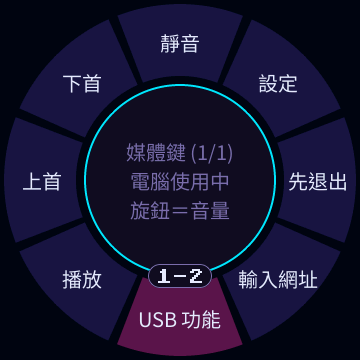
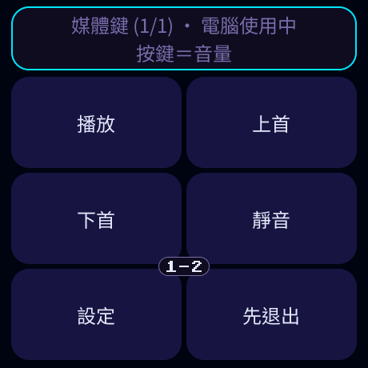
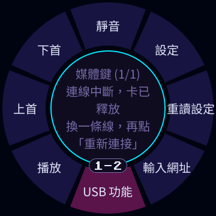

# 14. 外接模式：隨身碟、音效卡、按鍵

 

把JukeDial變成電腦配件的重開機模式。從選單進入；用武裝出口格（點兩下）離開，JukeDial會重新啟動。

- **USB 隨身碟（大容量儲存）：** TF 卡在電腦上出現成一顆碟。複製音樂、字型或設定檔，退出，離開模式。
- **USB 音效卡（UAC2）：** 電腦可以把聲音播到JukeDial的 DAC。格式 16／24／32 位元；提供的取樣率是 DAC 允許且不超過 `dac_max_rate` 的那幾檔（預設 44.1／48 kHz）。旋鈕（FakePod 用按鍵）調裝置音量。某個取樣率太吃資源時，描述元會拿掉它，螢幕會說明。這個模式在不同作業系統上的相容度還沒有完整驗證。
- **USB 按鍵（HID）與藍牙 BLE 按鍵（HOGP）：** 預設一層媒體鍵（播放／暫停、上下首、靜音）。更多層來自 `_player/config/keys.txt`；巨集與文字只送 ASCII。USB 與藍牙不會同時使用：有插線就用 USB，沒插就用 BLE（Just Works 配對）。
- 如果某個作業系統不接受三合一 USB 裝置，退路是兩合一（隨身碟加按鍵，或音效卡加按鍵）：模式裡的功能格會依序切換三合一、隨身碟＋按鍵、音效卡＋按鍵，要再點一下確認，然後重開模式。哪些作業系統需要它，目前還沒有完整驗證。

## 隨身碟模式與卡片保護
卡片也可以直接從設定進入隨身碟模式：設定 > 記憶卡與連線 > USB 隨身碟模式。電腦把卡當成一顆碟寫入時，播放器不能同時使用它，所以有這些保護：

- **每條離開的路都會把卡還給播放器。** 螢幕上離開、改功能組合、或電腦突然不見，都會先等寫入完成再釋放卡。
- **電腦不見就立刻釋放。** 拔線、斷電、電腦睡眠超過約 2 秒，畫面會顯示「連線中斷，卡已釋放」與「換一條線，再點『重新連接』」（電腦睡眠時是「電腦醒來後，點『重新連接』」）。換線或喚醒電腦後點**重新連接**；離開模式也隨時可以。如果電腦先「退出」了這顆碟再拔線，那是正常的安全移除，畫面會寫「已退出，可以拔了」。

  
- **卡沒有回應時說明原因與該做什麼。** 不正常拔線偶爾會讓卡卡在內部狀態，之後開機掛載失敗。設定第一行會出現「記憶卡無法使用」，點進去看原因：「記憶卡沒有正常回應」時，圓形板請用電源開關關機再開；FakePod 請重新插卡，或完全關機再開。沒有卡、讀不到卡會寫對應的說明。只有檔案系統問題（GPT、無法辨識的格式）才會出現格式化選項，卡沒有回應時絕不會給。

**名稱。**USB 裝置與磁碟顯示為「JukeDial」（各功能為「JukeDial Card」「JukeDial Keys」「JukeDial Sound」），TF 卡磁碟標籤是 JUKEDIAL；BLE 按鍵是「JukeDial Keys」。電腦或手機若記得舊名稱，可能要先移除舊項目（BLE 按鍵要重新配對）。

下一章：[安全模式與救援](15-safe-recovery.md)。
