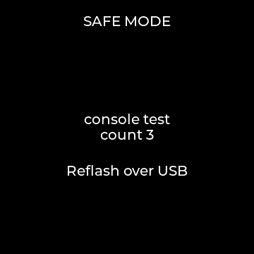

# 15. 安全模式與救援

- **開機迴圈保護。** 當機次數會跨重開機累計。連續三次之後，JukeDial進入靜態的 **SAFE MODE** 畫面（黑底、三行英文、亮度 40%、DAC 靜音、不理觸控和旋鈕），不碰卡、藍牙和 Wi-Fi。要用 USB 重新刷機才能離開（第 13 章）。
- **任何一次當機後**（panic、看門狗、欠壓），下一次開機會進正常JukeDial，但藍牙模式回到預設（藍牙關閉）。
- **當機時正在播的歌會被標示並略過。** 下一次開機後，那首歌在清單裡顯示「上次播放時當機，已略過」，不會再被自動挑到；自己點它就會播並清除標記（第 3 章）。
- **刷錯映像。** FakePod 的映像在圓形主板上拒絕執行，反之亦然（印出 "WRONG BOARD" 然後等著）。
- **開不了機或刷不進去：** 晶片永遠可以經 USB 進下載模式。插 USB 時用細針按住 BOOT 針孔（圓形機：USB-C 接頭旁邊的小孔；FakePod 沒有針孔，改成兩個鍵同時按住再開機或插上 USB），再用網頁工具或 `make flash-all` 刷機。請保留備份：網頁工具第一次刷機會提供原廠快閃的完整備份。
- **電量耗盡（FakePod）：** 欠壓重開機不會顯示安全畫面，避免點亮螢幕又欠壓的迴圈。
- 不要自己燒 eFuse 或使用深度睡眠，可能把自己鎖在外面。

下一章：[疑難排解與常見問題](16-faq.md)。
