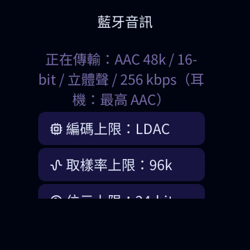
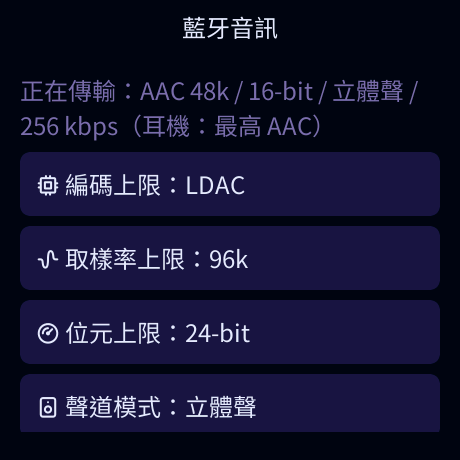
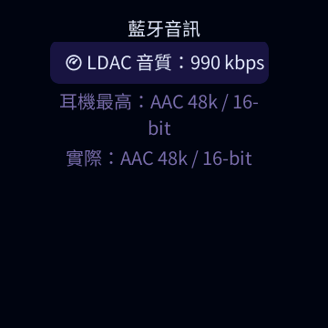
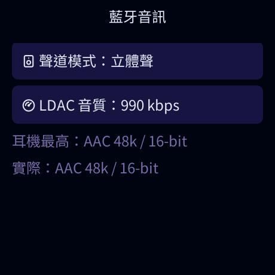
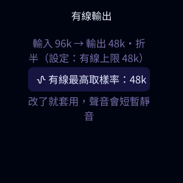
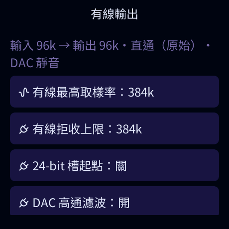
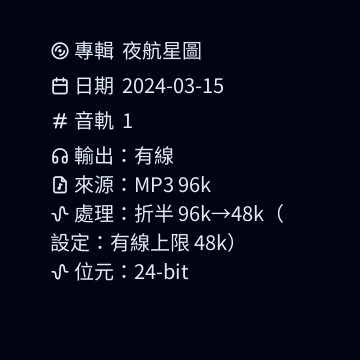
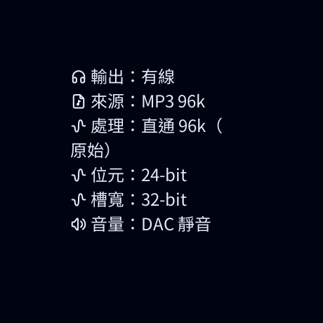
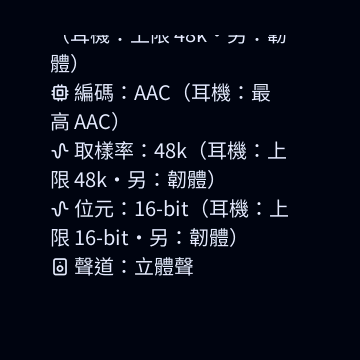
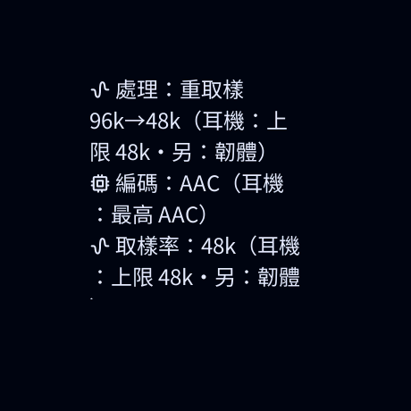

# 17. 音訊輸出：藍牙音訊、有線輸出與畫面上的誠實說明

JukeDial 不隱瞞它對聲音做了什麼。兩個設定頁決定上限，兩個地方回報實際結果。

## 藍牙音訊（設定 > 聲音 > 藍牙音訊）
 
- **即時行：**目前連線的編碼、取樣率、位元深度、聲道模式與位元率（例如「AAC 48k / 16-bit / 立體聲 / 256 kbps」）。
- **選項列：**編碼上限、取樣率上限、位元深度上限、聲道模式、LDAC 最高位元率（990／660／492／330 kbps；實際位元率會依連線品質在上限之內調整）。你選的是**上限**，不是保證：耳機與韌體版本只會把它往下壓。不再有灰掉的格子。
- **最後的資訊行：**「耳機最高：…」是耳機能提供的最好規格；「實際：…」是協商出的結果；未連線則顯示「未連線」。
- 改了選項會先存起來，**離開此頁時重新連線一次**。不會重開機，也不會動藍牙模式。

 

## 有線輸出（設定 > 聲音 > 有線輸出）
 
- 最上面一行是即時的：輸入取樣率、輸出取樣率，兩者不同時附原因（圖中是 96 kHz 檔案因有線上限 48k 而減半）。
- **有線最高取樣率**是「減半」門檻：高於它的檔案會在頻率族相符時以一半（或四分之一）的取樣率播放。圓屏預設 48 kHz，FakePod 預設 384 kHz。
- 僅 FakePod：**有線拒絕上限**（硬上限：高於它的檔案開啟前就拒絕，正在播的曲目不會被中斷，從下一個來源起生效）、**24 位元槽起點**（預設關，從指定取樣率起送 24 位元槽給 DAC，尚未在實機上驗證）、**DAC 高通**，以及**輸出推力**（1.0／1.41／1.73 V，見[第 19 章](19-fakepod.md)）。硬上限與減半門檻都是 384k 時，一切直通。
- 變更立即套用並短暫靜音（有三個以上值的選項是草稿，放開控制或離開頁面時才套用）。

## 兩塊板子的 DAC 怎麼處理
| | 圓屏（PCM5102A） | FakePod（CS43131） |
|---|---|---|
| 原生取樣率 | 1 到 48 kHz，以及 88.2 / 96 / 176.4 / 192 / 352.8 / 384 kHz | 32 到 384 kHz 直通 |
| 16 到未滿 32 kHz | 原生播放 | **升頻**到同一頻率族（22.05 到 44.1、24 到 32、16 到 32） |
| 低於 16 kHz | 原生播放 | **拒絕**，畫面說明原因 |
| 音量 | 數位 | **在 DAC 硬體內**（音訊路徑到 DAC 前保持單位增益），並讀回確認 |

藍牙與 Auracast 一律使用數位音量。有線輸出永遠使用有線自己的音量，藍牙遠端的音量不會影響它；FakePod 的有線路徑在數位端是單位增益，由 DAC 晶片硬體負責衰減。

## 誠實說明
- **詳細頁的輸出區塊**（從播放環開「詳細」，捲到最後）：每個事實一行、前面有圖示：輸出（有線／藍牙／Auracast）、來源（格式與取樣率）、處理、位元、槽寬、音量。每秒更新。
 
 
- **原因標籤。**凡是與檔案不同的行都會說明原因，並標出是誰決定的：檔案、設定、耳機、DAC、韌體、訊號、「忙碌」或模式（也有電量標籤，目前沒有東西會設它）。狀態行顯示最嚴格的原因，詳細頁列出全部。暫停的重型效果會明說，而不是默默停止。
- **直通**發生時會寫明（「直通（原始）」），倍速或效果迫使處理時也會寫明。

下一章：[主題配色](18-themes.md)。
