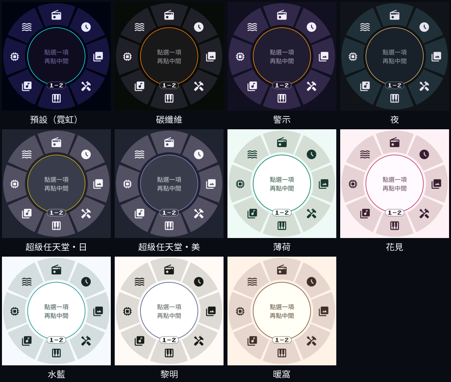
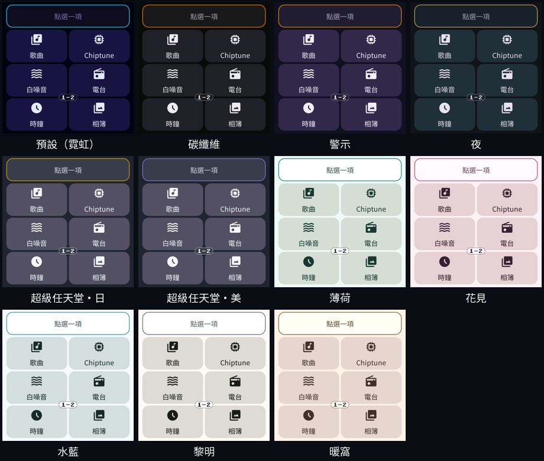

# 18. 主題配色

設定 > 顯示 > 配色 會逐一切換外觀：內建主題（預設是霓虹）加上**十個卡片主題**：碳纖維、警示、夜、超級任天堂·日、超級任天堂·美（深色），以及薄荷、花見、水藍、黎明、暖窩（淺色）。列上會以你的語言顯示主題名稱。淺色主題會讓 LVGL 切到淺色模式；遊戲棋盤在每個主題下都看得清楚。每個主題都通過對比檢查（內文至少 4.5:1，圖形至少 3:1）。

## 主題檔
- 卡片主題放在 `/sdcard/_player/themes/<名稱>.txt`；`_player/config/app.txt` 裡的 `theme=<名稱>` 決定用哪個（設定列會替你寫）。卡片範本（`make card-zip`）內含十個主題和 `template.txt`。
- 檔案是純文字：每行一個 `鍵 = #RRGGBB`，`#` 或 `;` 開頭是註解，`base = <內建主題>` 指定起點（預設 neon），調色盤項目寫成 `鍵.索引`，`name_tc` / `name_sc` / `name_en` 是顯示名稱。
- `template.txt` 列出所有顏色 token、預設值與中英文用途說明：複製、改名、改幾行即可。
- 壞行、未知鍵、壞值只會被略過並計數；檔案不存在或名稱不安全（只允許英數、`_`、`-`，最長 23 字）就回到預設外觀，絕不當機。
- 內建主題名稱優先於同名檔案。

下一章：[FakePod](19-fakepod.md)。
