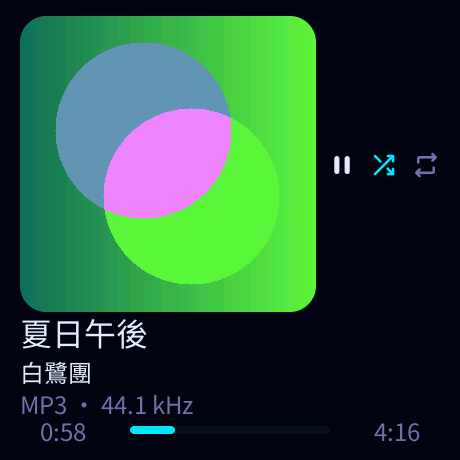
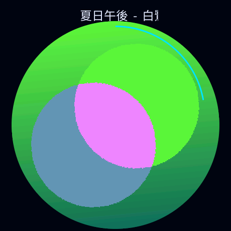
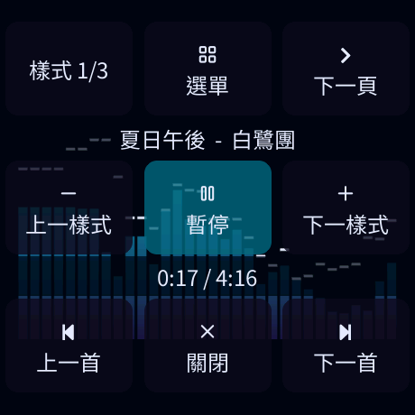
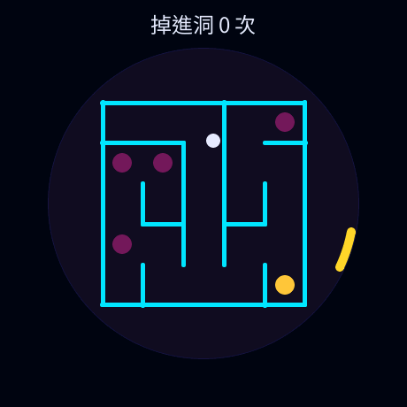

# 19. Fake Pod Nano Pro（FakePod）專屬操作

FakePod 是 460 × 460 的方形螢幕，沒有旋鈕，只有兩顆按鍵（上鍵＝「＋1」兼電源鍵，下鍵＝「－1」）加觸控。這一章集中說明它和圓形板不同的地方；其餘功能與前面各章相同。硬體差異見[第 0 章](00-hardware.md)。

## 三種播放頁
設定 > 顯示 > 播放頁樣式，三個值；下次進播放頁生效。

| 樣式 | 畫面 |
|---|---|
| 滿版封面（預設） | 整個螢幕都是封面，沒有任何按鈕，操作靠隱形九宮格 |
| 封面加資訊 | 封面在左上，下面是歌名、演出者、格式行與進度條；右側三個圖示只顯示狀態（播放／暫停、隨機、循環），不能點 |
| 選單格 | 與圓形板相同的旋轉圓盤，點一下開啟播放環 |

  

進度條只顯示位置，不能點著跳；播放器沒有「跳到某個位置」的功能。

## 九宮格點擊區
滿版封面、封面加資訊與頻譜頁都不畫螢幕上的按鈕，而是整頁分成 3 × 3 等大的隱形點擊區。**第一下點螢幕只會顯示九個格子的標籤；第二下點某一格才執行。**沒顯示標籤時點螢幕不會執行任何動作；標籤約 4 秒沒有觸碰會自動收起，點中間下排的「關閉」格會立刻收起。標籤顯示期間，頻譜、旋轉的封面與相簿照片會暫停（進度條與時間照走）。

 

格子位置：

| | 左 | 中 | 右 |
|---|---|---|---|
| 上排 | 切換組合 | 選單 | 下一頁 |
| 中排 | 左功能 | 播放／暫停 | 右功能 |
| 下排 | 上一首 | 關閉 | 下一首 |

- **切換組合**會顯示「名稱 i／n」，輪流換掉中排左右兩格的功能（各頁的選擇在開機期間記住）。封面頁只有「播放模式」：左格是隨機（開／關），右格是循環（全部／單曲）。頻譜頁有三組：樣式（上一個／下一個樣式）、配色，以及播放模式。
- **下一頁**依序走封面 → 頻譜頁 → 歌詞（只有曲目旁邊有同名的 `.lrc` 檔時才有）→ 回封面。
- **選單**開啟該頁原本的選單（播放環等）。

## 頻譜頁
頻譜頁的樣式、配色與播放模式都是上面的組合，用九宮格操作；種類與進階設定見[第 3 章](03-music.md)。

## 清單、音量與按鍵
- **較大的清單。** 清單列與按鈕更大、更好點，每頁六列。
- **音量提示。** 按上下鍵調音量時，下方顯示一個膠囊（喇叭圖示、音量條、數字），幾秒後消失（第 10 章）。
- **螢幕關著時叫醒。** 螢幕關著時，**兩顆鍵同時按**才會點亮螢幕；碰觸螢幕不會叫醒（避免放口袋裡誤觸）。螢幕一定會在閒置後關閉（OLED 久亮會烙印）。
- **螢幕關著的盲按鍵。** 有播放來源時：按上鍵一下音量加、按下鍵一下音量減（按住連續調）；上鍵連按兩下＝下一首，下鍵連按兩下＝播放／暫停。單按因此晚約 0.3 秒才生效。沒有播放來源時，任何鍵都會點亮螢幕。

## 傾斜迷宮與動作感測器
遊戲「旋鈕小玩意」在 FakePod 上的第一個玩法是傾斜迷宮：把機器傾斜，彈珠就往那個方向滾，掉進洞就回到起點，滾到出口過關。動作感測器會在機器靜止時自動校正比例；進入迷宮時會自動取目前的姿勢當中立點，拿不穩時畫面會提示「請拿穩或放平，再點重新歸零」，規則環裡的**重新歸零**可以隨時重設中立點。

## 時鐘
FakePod 有內建的即時時鐘：設定時間（第 6 章）或 Wi-Fi 對時後，關機、斷電後時間仍會保留。

## 輸出推力
設定 > 聲音 > 有線輸出 > 輸出推力，三檔：**1.0 V**、**1.41 V**、**1.73 V**。1.73 V 是**實驗性**的高電壓模式：比 1.0 V 大約 4.8 dB，晶片廠只保證用在 600 Ω 以上的耳機，低阻抗入耳式耳機增益很小、還可能失真；從 1.41 V 切到 1.73 V 時，第一下點只顯示警告，第二下才生效。每次調高推力時，如果音量高於 20，會自動降到 20。列下方會顯示晶片實際使用的推力。

## 不支援的項目
- 耳機插孔偵測與線控：不支援（這塊板沒有接到可用的偵測腳）。
- 螢幕上的圓形按鈕：已被九宮格取代。

## 下載模式與刷機
兩顆鍵**同時按住再通電**就進下載模式。可以用託管的網頁工具（第 13 章：「刷機」分頁，板子選「FakePod（方形螢幕、兩個按鍵）」；寫完頁面會用 watchdog 重設，若畫面一直不亮，就拔掉 USB 線和電池電源再接回去，不要按任何鍵），或用 esptool 手動寫入合併映像（第 13 章；寫完要用 watchdog 重設才會離開下載模式）。從原始碼建置的步驟在[第 20 章](20-build-flash.md)。

下一章：[從原始碼建置與刷機](20-build-flash.md)。
